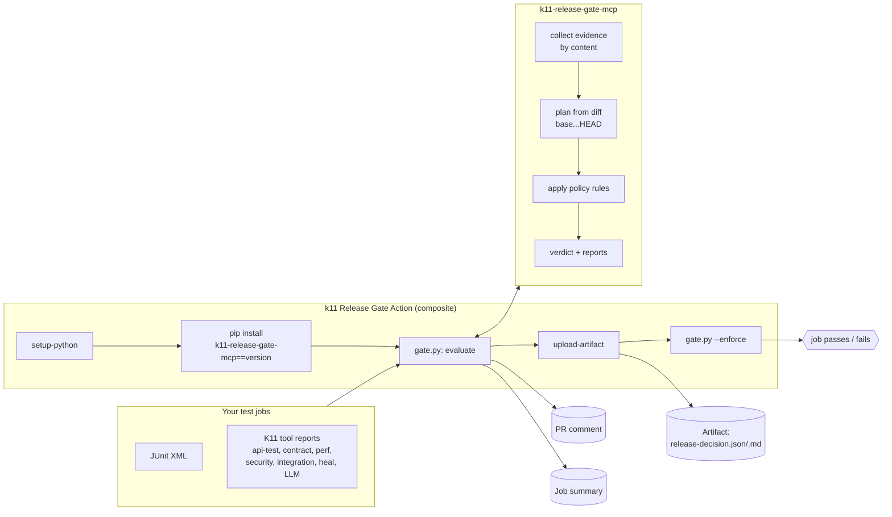

# Design and implementation

How the k11 Release Gate Action works, and why it is built this way.

- [Goals](#goals)
- [Architecture](#architecture)
- [Step by step](#step-by-step)
- [Key design decisions](#key-design-decisions)
- [Security model](#security-model)
- [Testing](#testing)
- [Limitations](#limitations)
- [Versioning](#versioning)

## Goals

1. **One answer per pull request.** Turn scattered QA reports into a single verdict: `ship`, `ship_with_conditions`, `needs_human` or `block`.
2. **Deterministic.** The same evidence and policy always give the same verdict. No model, no randomness, no network calls to decide.
3. **Change-aware.** Require the evidence a change actually needs, worked out from the diff. A Kafka consumer change needs integration tests; a README change doesn't.
4. **Explainable and auditable.** Every finding names its rule and the evidence file it came from. The decision record lists each file's SHA-256.
5. **One line to adopt.** Sensible defaults, no setup beyond the workflow step, and it works from GitHub's default shallow checkout.
6. **Read-only.** It reads reports. It never calls the system under test and never changes code.

The decision logic is not in this repository. It lives in [k11 Release Gate](https://github.com/K11-Software-Solutions/k11techlab-release-gate-mcp)
(`k11-release-gate-mcp` on PyPI), which is also an MCP server and a CLI. This action is a thin, CI-specific wrapper around it,
so a verdict in CI, in Claude Code and on a laptop is the same verdict.

## Architecture

Files in this repository:

| File | Role |
|---|---|
| `action.yml` | The composite action: inputs, outputs and five steps |
| `gate.py` | Runs inside the action: resolves the base ref, calls the gate, sets outputs, comments on the PR; `--enforce` mode decides pass or fail |
| `examples/` | Copy-ready workflows: single job, tag release with sign-off, monorepo |
| `docs/` | This documentation |

## Step by step

### 1. Set up Python and install the gate

`actions/setup-python@v5` with `python-version` (default 3.12), then
`pip install "k11-release-gate-mcp==<version>"`. The gate version is **pinned** (default `0.4.0`, the version this
action release was tested with), so a new gate release never changes your verdicts until you choose to upgrade.

### 2. Evaluate (`gate.py`)

1. **Resolve the base ref** (input `base`):
   - `auto` on a pull request becomes `origin/<the PR's base branch>`; on a push there is no base, so no change-triggered evidence;
   - `none` turns change-awareness off; any other value is used as given (e.g. `origin/main` on a tag release).
   - The ref is checked against `^[\w./-]+$` and must not start with `-` before it reaches git.
2. **Make the diff possible.** The gate compares `base...HEAD` (three dots: changes on this branch since it left the base),
   which needs the common ancestor commit. `actions/checkout` fetches one commit by default, so the action:
   - fetches the base branch if `origin/<branch>` isn't known;
   - if there is still no common commit and the clone is shallow, runs `git fetch --unshallow` and fetches the base again;
   - if that still fails, warns and evaluates **without** change-triggered evidence, rather than failing the job.
3. **Run the gate**: `k11-release-gate-mcp evaluate --fail-on never --report-dir .qa-mcp/release-gate --label <label> [--policy …] [--base …]`
   in `working-directory`. The label defaults to `PR #<n>`, else the tag name on a tag push, else the short commit SHA.
4. Inside the gate:
   - **Collect evidence** from the policy's glob patterns. Each file's kind is recognised from its **content**, not its name,
     so a report can be anywhere. Unreadable files are kept as findings, never skipped.
   - **Plan**: changed files are matched against trigger patterns per evidence kind (built-in defaults plus your policy's `triggers`).
     A kind is needed if the policy always requires it or the change triggers it.
   - **Rules**: about 37 rules turn facts into findings, each with an outcome: `block`, `needs_human`, `conditional` or `info`.
     Missing required evidence is `evidence.missing` (block by default); evidence older than `max_age_hours` is `evidence.stale`.
   - **Verdict**: the worst outcome wins (`block` > `needs_human` > `conditional` > `info`), mapped to
     `block`, `needs_human`, `ship_with_conditions` or `ship`.
   - Writes `release-decision.md` and `release-decision.json`, appends the Markdown to the **job summary**, and writes outputs.
5. **Set outputs** (`verdict`, `blockers`, `needs-human`, `conditions`, `decision-json`, `decision-markdown`), with absolute paths
   so later steps can use them from any directory.
6. **Comment on the pull request** (when `comment: true` and the run is for a PR): see [the PR comment](#the-pr-comment).

The step always succeeds when a decision was produced, whatever the verdict. It fails only if the gate couldn't decide
(for example an invalid policy file), and then says so in the log.

### 3. Upload the decision

`actions/upload-artifact@v4` uploads `release-decision.json` and `.md` as the artifact `release-decision`. It runs under
`always()`, so the audit record is kept even when an earlier step failed.

### 4. Enforce (`gate.py --enforce`)

Compares the verdict with `fail-on`:

| `fail-on` | Fails the job on |
|---|---|
| `block` (default) | `block` |
| `needs-human` | `block`, `needs_human` |
| `conditions` | `block`, `needs_human`, `ship_with_conditions` |
| `never` | nothing: use the `verdict` output yourself |

### The PR comment

- The body starts with a hidden marker, `<!-- k11-release-gate -->`. On each run the action pages through the PR's comments
  (up to 1,000), **updates** the comment with the marker if there is one, and **creates** it otherwise. A PR therefore has
  one gate comment that always shows the latest decision, not one per push.
- It uses the REST API directly (`urllib`), not the `gh` CLI, so it works on self-hosted runners without extra tools,
  and honours `GITHUB_API_URL`, so it also works on GitHub Enterprise Server.
- If the token can't comment (HTTP 403 or 404), the step logs a warning with the permission to add. It doesn't fail, because a
  missing comment shouldn't hide the verdict.

## Key design decisions

**Composite action, not JavaScript or Docker.** The gate is a Python package, so a composite action that installs it is the
smallest wrapper: no bundled `node_modules`, no image to build or pull, and it runs on Linux, Windows and macOS runners.
A Docker action would be Linux-only and slower to start.

**Evaluate and enforce are separate steps.** Evaluate never fails on the verdict, so the comment, job summary and artifact are
always produced. Only then does the enforce step fail the job. A blocked PR shows *why* it is blocked, not just a red X.

**Pinned gate version.** Release gates must be predictable: the same commit should get the same verdict next month.
Upgrading the gate is a visible, reviewable change to the workflow (`version:`).

**Change-awareness from git, not from the GitHub API.** The diff is computed locally with `base...HEAD`, the same way the CLI and
the Claude Code agent do it. Results are identical everywhere, and it needs no token or extra permission.

**Degrade, don't fail, on infrastructure problems.** A base ref that can't be found or a comment that can't be posted becomes a
warning, and the gate still decides with what it has. Only a decision that can't be made fails the step.

**Evidence recognised by content.** Teams store reports in different places. Detecting the kind from the JSON's shape and its `tool`
field means one policy file works across repositories, and a renamed report is still read.

## Security model

- **Permissions.** Needs `contents: read`, plus `pull-requests: write` only for the comment. Set `comment: false` and the token isn't used.
- **No secrets.** The action needs no API keys. The token is used only to call the GitHub comments API.
- **Untrusted text stays out of shell code.** Inputs reach `gate.py` as environment variables, not by being pasted into shell
  scripts, and refs are validated before git sees them. (The `version` and `python-version` inputs are written by the workflow author.)
- **Network.** PyPI (to install the gate) and the GitHub API (the comment). Evidence never leaves the runner, apart from the
  artifact you upload and the comment text.
- **Supply chain.** The gate is installed at an exact version from PyPI, where it is published from its repository with Trusted
  Publishing (no long-lived upload token). For the strictest setups, pin this action to a commit SHA instead of `@v1`.
- **Fork pull requests.** On `pull_request` events from forks, GitHub gives the workflow a read-only token, so the comment
  is skipped with a warning; the verdict, job summary and artifact still work. See [Limitations](#limitations).

## Testing

- **Locally**, against `k11-release-gate-mcp` 0.4.0 from PyPI: verdicts on real evidence, every `fail-on` threshold, `base`
  `auto`/`none`/invalid, labels for PRs and tags, a shallow clone where the base branch is unknown (the action deepens it and the
  diff still drives the plan), and the PR comment against a mock of the GitHub API (created on the first run, updated on the second).
- **On GitHub-hosted runners**, before v1.0.0 (a temporary branch, so the published repository has no workflow files):
  - `block` on **ubuntu-latest, windows-latest and macos-latest**: outputs, the decision file, and `fail-on: block` failing the step;
  - `ship` with a JUnit-only policy;
  - change-triggered: a changed Kafka consumer under a shallow checkout made `integration` required;
  - one PR comment and the `release-decision` artifact.
- The decision logic itself is covered by the 27 tests in [k11 Release Gate](https://github.com/K11-Software-Solutions/k11techlab-release-gate-mcp),
  using real reports from each K11 tool.

## Limitations

- **Fork PRs can't be commented on** with the default token. For public repos that accept forks, either rely on the job summary,
  or run the gate in a `workflow_run` workflow that has write access and reads the artifact. Never check out and run fork code under
  `pull_request_target`.
- **One gate comment per PR.** Several gates in one PR (a monorepo matrix) would overwrite each other's comment: use `comment: false`
  and the job summary, as in [`examples/monorepo.yml`](../examples/monorepo.yml).
- **Evidence must be on the runner.** The gate reads files. If tests run in other jobs, upload their reports and download them
  before the gate (`actions/download-artifact`).
- **Evidence age** is read from the report's own timestamp. Old reports committed to the repository will be flagged as stale
  (`max_age_hours`, default 24).
- **Python on the runner.** `setup-python` must be able to install the requested version (all GitHub-hosted runners can).

## Versioning

- Releases follow semantic versioning: `v1.0.0`, `v1.0.1`… The moving tag `v1` points at the latest 1.x release.
- A new **gate** version (new evidence kinds, new rules) ships as a new action release that changes the `version` default;
  pin `version:` to stay on an older gate.
- Breaking changes to inputs or outputs would only come in `v2`.
